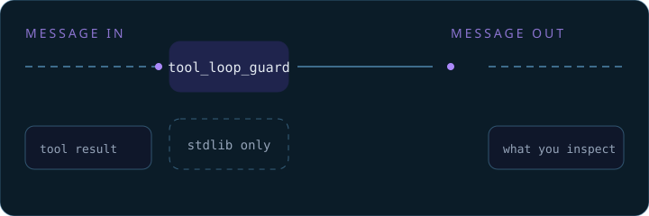

<p align="center">
  
</p>

<p align="center">
  <a href="https://pypi.org/project/tool-loop-guard/"></a>
  <a href="https://pypi.org/project/tool-loop-guard/"></a>
  <a href="https://pypi.org/project/tool-loop-guard/"></a>
  <a href="https://github.com/sandeshbagmare/tool-loop-guard/actions/workflows/ci.yml"></a>
  <a href="https://github.com/sandeshbagmare/tool-loop-guard/blob/main/LICENSE"></a>
  <a href="https://sandeshbagmare.github.io/tool-loop-guard/"></a>
  <a href="https://pypi.org/project/tool-loop-guard/"></a>
</p>

<h3 align="center">catch an agent repeating itself while it is still cheap</h3>
<p align="center"><em>Standard library only. No runtime dependencies. Python 3.9+.</em></p>

<p align="center">
  
</p>

## Install

```console
pip install tool-loop-guard
```

## Use

```python
from tool_loop_guard import LoopDetected, LoopGuard

guard = LoopGuard(max_repeats=3, cycle_length=4)

def call_tool(name, arguments, tool):
    decision = guard.observe(name, arguments)
    if decision.action == "stop":
        return f"Stopped: {decision.reason}. Change your approach or ask the user."
    if decision.action == "warn":
        return f"{decision.reason}; you are repeating yourself."
    return tool(**arguments)
```

Or let it raise:

```python
try:
    guard.check("search", {"q": "python"})
except LoopDetected as error:
    error.decision.action, error.decision.reason
    # ('stop', 'repeating cycle of 2 calls: read ↔ search')
```

Wrapping a tool registry, which is the shape a LangGraph or Deep Agents middleware
takes:

```python
def wrap(tool, name, guard):
    if asyncio.iscoroutinefunction(tool):
        async def guarded(**arguments):
            decision = guard.observe(name, arguments)
            if decision.action == "stop":
                return {"error": decision.reason, "action": "stop"}
            return await tool(**arguments)
    else:
        def guarded(**arguments):
            decision = guard.observe(name, arguments)
            if decision.action == "stop":
                return {"error": decision.reason, "action": "stop"}
            return tool(**arguments)
    return guarded
```

## Why the signature works

`signature(name, arguments)` is order-insensitive: `{"a": 1, "b": 2}` and
`{"b": 2, "a": 1}` are the same call, nested dicts are canonicalised, surrounding
whitespace in strings is dropped, and strings longer than 200 characters are truncated
before hashing — a model that re-emits a 4 000 character file body as an argument is
still caught. The name is part of the signature, so `write_file` and `read_file` with the
same path are different calls.

## Rules

| setting | default | meaning |
| ------- | ------- | ------- |
| `max_repeats` | 3 | the count at which an identical call stops the run |
| `cycle_length` | 4 | the longest period looked for in `A B A B` |
| `window` | 40 | how many recent calls are kept; must be ≥ 2 × `cycle_length` |

- `action` is `"allow"`, `"warn"` (one call before the limit) or `"stop"`.
- a `Decision` is truthy while allowed, so `if not guard.observe(...)` also reads well.
- the guard is in-memory and cheap; keep one per run and call `reset()` between runs.

## Limits

- It sees tool calls only. A model that loops inside one long generation is invisible
  until it returns, so pair it with a token budget.
- A cycle whose period is longer than `cycle_length` is not a loop by this definition.
- Two different calls that mean the same thing (`read a.txt` and `read ./a.txt`) are
  different signatures; normalise the arguments before calling `observe` if you have
  aliases like that.

## Development

```console
python -m venv .venv
.venv/bin/pip install -e ".[test]"
.venv/bin/pytest
```

## License

MIT.
